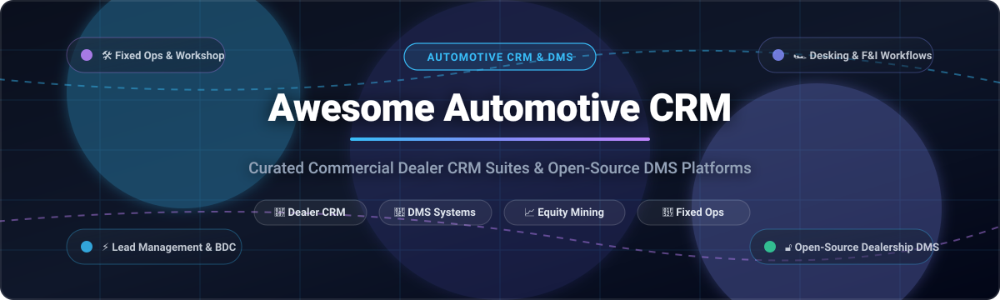

# Awesome-Automotive-CRM

# Awesome-Automotive-CRM 🚗 🤝

  

  

  

  

  

  

  

---

## 🌟 Top Automotive CRM Ecosystem

**Curated List of Commercial Dealer CRM Platforms & Open-Source Dealership Management Systems**  

*Focused on Lead Management, Desking, F&I, Service Scheduling, Inventory Integration, Equity Mining & Self-Hosted Dealer Operations*

**Last updated: October 2026** 📅

---

### 📌 Overview & SEO Summary

Welcome to the ultimate curated directory of **automotive CRM platforms**, **open-source dealership management systems**, and **dealer operations frameworks**. Whether you are looking for enterprise-grade commercial solutions (such as *Salesforce Automotive Cloud*, *VinSolutions*, and *CDK Global*), or self-hostable open-source alternatives (like *Galpon*, *Car Warehousing Management System*, and *Dealership Management System*), this list covers category leaders, lead management, and privacy-respecting dealer CRM infrastructure.

**Key Market Context:**

- **Salesforce Automotive Cloud** Enterprise Edition costs **$350/user/month** (billed annually), with Unlimited at **$525/user/month** and Agentforce 1 editions at **$750/user/month** .

- **VinSolutions** monthly license runs **$750–$1,500+/month** with setup/migration costs of **$5,000–$15,000**, while **DealerSocket** runs slightly lower at **$650–$1,400+/month** — both quote-based with real costs depending on store size and lead volume .

- **DealerSocket CRM** has published pricing starting at **$20 per user, per month** according to Capterra .

- **Elead CRM** (now part of CDK Global) is one of the most widely deployed automotive CRMs in North America, with **30+ years in the industry** and **~1,000 employees**, serving customers from small single-point dealers (69.7% of users) to enterprise groups like OpenRoad Auto ($2B revenue) .

- **CDK Global** does not publish standard SaaS-style price cards for DMS or Fortellis — **DMS pricing is per-dealer, per-rooftop, custom-quoted** with multi-year contracts and per-module add-ons .

- **DriveCentric** is priced **by rooftop and units sold count**, centered around its core CRM (Engagement Hub), with annual or multi-year agreements invoiced monthly .

- **Galpon** is a **local CRM system for auto repair workshops** built with **FastAPI, SQLModel, SQLite, Jinja2, and TailwindCSS** .

- **Dealership Management System (alamariful1727)** is a **backend system with PostgreSQL schema and GraphQL API** (NodeJS/Express/TypeScript) supporting multi-dealership vehicle inventory, customer records, and sales transactions .

- **Car Warehousing Management System** is a **web-based platform built with PHP, MySQL, and XAMPP** for managing vehicle inventory, customer interactions, and dealership operations .

- **Dealership Management System (HeldanaG)** is a **Java-based inventory and contract management system** supporting multiple dealerships with per-dealer inventory files (CSV), sales and lease contract processing, and financing logic based on price tiers .

---

## 📑 Table of Contents

- [🏢 SaaS & Commercial Platforms](#-saas--commercial-platforms)

- [🔓 Open-Source GitHub Projects](#-open-source-github-projects)

- [🛠️ How to Contribute](#%EF%B8%8F-how-to-contribute)

- [📊 Star History](#-star-history)

- [🤝 Support & Sponsorship](#-support--sponsorship)

- [⚠️ Disclaimer](#%EF%B8%8F-disclaimer)

---

## 🏢 SaaS & Commercial Platforms

> **Market Size & Structure Analysis:** The global automotive CRM and dealership software market is estimated at **$6.74 billion in 2025** and projected to reach **$10.24 billion by 2030** (CAGR ~8.7%). The industry displays a **concentrated oligopoly at the tier-1 franchised dealership level**—with CDK Global, Cox Automotive (VinSolutions), and Reynolds & Reynolds controlling over 60% of major dealer group workflows due to deep OEM factory-integration lock-in. Concurrently, it remains **moderately fragmented in the mid-market and independent dealer space**, where agile, cloud-native CRM platforms (such as DealerSocket, DriveCentric, DealerCenter, and Selly Automotive) compete vigorously on digital retailing, messaging compliance, and transparent desking.

| SaaS / Commercial Platform | Company / Owner | Valuation / Market Size / Revenue | Pricing (Standard Edition Starting Price) | Free Tier / Free Trial Limits | Description |
| :--- | :--- | :--- | :--- | :--- | :--- |
| **[Salesforce Automotive Cloud](https://www.salesforce.com/automotive/cloud/)** ☁️ | Salesforce | ~$250 Billion Valuation | **$350/user/month** (Enterprise Edition, billed annually) | **30-day full-featured free trial**; no credit card required; base and pre-configured org options available | Enterprise automotive CRM built on Sales and Service Cloud with automotive-specific data models, vehicle console, and household relationship mapping. Unlimited Edition at $525/user/month; Agentforce 1 Sales/Service edition at $750/user/month with Einstein AI and Data Cloud. |
| **[VinSolutions](https://www.vinsolutions.com/)** 🔵 | Cox Automotive (Cox Enterprises) | ~$22 Billion Annual Revenue (Parent) | **$750/month** (starting base tier; typical stores run $750–$1,500+/month) | **No free tier or public free trial**; interactive personalized product walkthrough demo available upon request | Dealer CRM with deep Cox ecosystem integration (Autotrader, Kelley Blue Book, vAuto). Connect CRM features desking, equity mining (TargetConnect), and service scheduling. Onboarding/migration typically costs $5,000–$15,000. |
| **[DealerSocket](https://dealersocket.com/)** 🟢 | Solera (Vista Equity Partners) | ~$6.5B - $10B+ Valuation | **$20/user/month** (base modular starting tier per Capterra; full store deployments typically start at $650–$1,400/month) | **No free tier or self-serve trial**; guided sales demonstration and sandbox walkthrough available upon request | Comprehensive dealer CRM platform uniting CRM, desking, inventory management (Inventory+), and service scheduling. Scaled modularly for both independent and multi-franchise auto dealerships. |
| **[CDK Global](https://www.cdkglobal.com/)** 🏢 | CDK Global (Brookfield) | ~$8.3 Billion Acquisition Valuation | **$1,200/month** (starting per-rooftop entry tier for core DMS/CRM modules under multi-year contract) | **No free tier or public trial**; live custom dealership environment demo available upon request | Tier-1 dealership management suite. DMS Foundations core handling accounting, F&I, parts, inventory, and service drive operations. Seamlessly integrates Elead CRM without third-party middleware. |
| **[Elead CRM](https://www.eleadcrm.com/)** 🟠 | CDK Global (Brookfield) | ~$8.3 Billion Acquisition Valuation (CDK) | **$750/month** (starting per-store tier within CDK suite; typically $750–$1,500/month depending on user count) | **No free tier or public trial**; live guided sales demo available upon request | Enterprise automotive CRM and BDC platform deployed across 30+ years in automotive retail. Native zero-middleware CDK DMS synchronization for showroom desking, BDC call centers, and service follow-ups. |
| **[Reynolds and Reynolds](https://www.reyrey.com/)** 🔴 | Reynolds and Reynolds | ~$2.8B Acquisition / ~$1B+ Revenue | **$1,000/month** (starting DMS/CRM tier; standard franchise rooftop contracts range $1,000–$5,000+/month) | **No free tier or trial**; live consultative system demonstration available upon request | Dealer retail platform powered by ERA-IGNITE DMS and FOCUS CRM. Single customer identifier across showroom, service drive, and accounting with multi-year agreements and RCI certified interfaces. |
| **[DriveCentric](https://drivecentric.com/)** 🟣 | DriveCentric (Warburg Pincus) | ~$1.4 Billion Valuation | **$1,000/month per rooftop** (starting base tier for Engagement Hub; additional add-ons from $500/month) | **No free tier or self-serve trial**; live interactive product demonstration available upon request | Modern AI-first automotive CRM. Engagement Hub core CRM featuring live video messaging, conversational AI assistant (AIM), and workflow automation (Automation Hub). Invoiced monthly under annual contracts. |
| **[DealerCenter](https://www.dealercenter.com/)** 🚗 | NowLake Technology / Hankey Group | ~$10B - $15B Assets (Parent Group) | **$50/month** (starting tier; standalone DMS from $60/mo, CRM Plus from $99/mo, CRM Pro from $199/mo) | **30-day free trial**; access to inventory management, CRM tools, and mobile app features | All-in-one DMS & CRM for independent dealers. Features inventory management, CRM desking, Buy Here Pay Here (BHPH) servicing, credit bureau checks, and digital paperwork integration. |
| **[PBS Systems](https://www.pbssystems.com/)** 🟤 | PBS Systems | ~$100M - $220M Revenue | **$1,000/month** (starting baseline DMS & CRM modular package per rooftop) | **No free tier or public trial**; customized consultative product demonstration available upon request | Integrated DMS and dealership CRM. Microsoft-centric v10 APEX platform uniting accounting, sales CRM, parts, and service lane operations into a unified dealership database. |
| **[AutoRaptor](https://www.autoraptor.com/)** 🟡 | AutoRaptor | ~$2M - $5.3M Revenue | **$399/month** (starting base tier for independent auto dealerships) | **No free tier or self-serve trial**; live 15-minute 1-on-1 guided demonstration available upon request | Automotive CRM purpose-built for independent and BHPH dealers. Features lead nurturing, automated text/email messaging, mobile VIN barcode scanning, and seamless inventory management without long contracts. |
| **[Selly Automotive](https://www.sellyautomotive.com/)** 🔵 | Selly Automotive (A1 Software Group) | ~$2.7M - $6.4M Valuation / ARR | **$140/month** (starting base tier for independent dealerships) | **No free tier or self-serve trial**; personalized 1-on-1 live walkthrough demo available upon request | Mobile-first CRM for independent and used-car dealers. Includes internet lead management (ILM), two-way compliant SMS texting, paperless desking, driver license scanning, and DMS integrations. |

---

## 🔓 Open-Source GitHub Projects

*Sorted by GitHub Stars Count (Descending)* 🌟

- **[Autorizz Dealership System](https://github.com/Defcon27/Autorizz-Car-Dealership-System-using-NodeJS-Express-MongoDB)**   
  **Web-based DMS and dealership management application**, open-source. **Node.js + Express + MongoDB** . Streamlines automobile dealership operations, customer vehicle requests, showroom inventory, and sales order processing into an interactive dashboard. 🏎️

- **[Car Dealership Management Program](https://github.com/PP-Namias/Car-Dealership-Management-Program)**   
  **High-performance car dealership management software**, open-source. Built entirely in **C++** with object-oriented dealership modeling, vehicle transaction processing, customer profiling, and local data persistence. 💻

- **[Car Service Management System](https://github.com/jdinovo/CarServiceManagementSystem)**   
  **Desktop DMS application for automotive service centers**, open-source. **Java + SQL database** . Enables dealership service managers and technicians to track customer repair orders, manage vehicle maintenance histories, record parts replacements, and log labor hours. 🛠️

- **[Dealership Management System (alamariful1727)](https://github.com/alamariful1727/dealership-management-system)**   
  **Backend system for automotive dealership operations**, open-source. **PostgreSQL schema with dealerships, vehicles, customers, and sales tables** . **GraphQL API built with NodeJS, Express, and TypeScript** . Optimized indexes for vehicle inventory queries (make/model/year), dealer filtering, and multi-rooftop transaction records. 🏗️

- **[Car Showroom Management System](https://github.com/ShravanDalavi/Car-Showroom-Management-System)**   
  **Modern car showroom management application**, open-source. Transforms traditional auto showroom operations with digital vehicle catalogs, customer inquiry management, quotation generation, and test-drive tracking. 🏢

- **[Car Workshop Management App](https://github.com/alxayeed/car_workshop)**   
  **Cross-platform auto repair and workshop booking app**, open-source. **Flutter + Firebase + GetX Clean Architecture** . Features secure authentication, role-based access for mechanics and vehicle owners, real-time maintenance schedule tracking, and service booking. 📱

- **[Car Dealership Management System (khmorad)](https://github.com/khmorad/Car_Dealership_Management_System)**   
  **Full-stack dealership web platform**, open-source. Integrates inventory management, customer communications, sales order tracking, and post-sale reporting into a unified automotive retail workflow. 📊

- **[Car Repair Management System](https://github.com/ishimweghislain/Car-Repair-Management-system)**   
  **Auto repair workshop workflow system**, open-source. Tracks repair jobs, customer diagnostic records, parts inventories, and workshop technician assignments. 🔧

- **[Car Dealer AI Agent](https://github.com/ahkamboh/car-dealer-ai-agent)**   
  **AI-powered CRM agent for car dealerships**, open-source. Named Cortex, designed specifically for autonomous customer engagement, vehicle inquiry handling, test-drive scheduling, and automotive sales intelligence. 🤖

- **[Galpon](https://github.com/TeodorArg/galpon)**   
  **Local CRM system for auto repair workshops**, open-source. **FastAPI + SQLModel + SQLite + Jinja2 + TailwindCSS** . Centralized CSRF protection, Alembic database migrations, media validation tools, and complete workshop repair order handling. 🔩

- **[CarSale-CRM](https://github.com/mehdimirzaeeofficcial-cyber/carsale-crm)**   
  **Comprehensive CRM for installment car sales**, open-source. **Node.js + Tailwind CSS + PWA** . Customer management, installment payment schedule tracking, vehicle catalog, and multi-channel messaging (SMS, WhatsApp). 💳

- **[Dealership Management System (HeldanaG)](https://github.com/HeldanaG/CarDealerShip)**   
  **Java-based inventory and contract management for multiple dealerships**, open-source. **Java JDK 17+** . Search by price and vehicle type, sales/lease contract calculation algorithms, and per-dealer CSV data persistence. ☕

- **[Car Warehousing Management System](https://github.com/zahmed02/CS2005-DBMS-Car-Warehousing-Management-System)**   
  **Web platform for vehicle inventory and dealership operations**, open-source. **PHP + MySQL + XAMPP** . Complete vehicle warehousing, customer records, and dealership sales tracking. 🎓

---

## 🛠️ How to Contribute

Contributions are welcome! Follow these steps to submit new automotive CRM platforms or open-source dealership management software:

1. 🍴 **Fork** the repository.

2. 📝 **Add/edit** entries in `README.md` maintaining table/list structure and formatting.

3. 🔗 Include project title, official website/GitHub link, exact Stars_Count, license, and brief description.

4. 🚀 Submit a **Pull Request** with a descriptive summary of your changes.

---

## 📊 Star History

---

## 🤝 Support & Sponsorship

If you find this automotive CRM repository useful, please consider supporting the project:

- ⭐ **Star** this repository to increase visibility!

- 🔀 **Fork** and share with fellow dealership operators, automotive sales leaders, and open-source advocates.

- ☕ **Sponsor & Buy Me a Coffee**: Support ongoing open-source curation via the [GitHub Sponsor Dashboard](https://github.com/sponsors/ishandutta2007).

---

## ⚠️ Disclaimer

- This is a **community-curated** list — not exhaustive and not an endorsement. ℹ️

- **Salesforce Automotive Cloud Enterprise Edition costs $350/user/month** (billed annually) . **VinSolutions runs $750–$1,500+/month with $5,000–$15,000 setup/migration** . **DealerSocket published pricing starts at $20/user/month**, but real deployments run **$650–$1,400+/month** . **CDK Global DMS pricing is per-dealer, per-rooftop, custom-quoted with multi-year contracts** . **DriveCentric is priced by rooftop and units sold** .

- **Elead CRM is now part of CDK Global** — **native DMS integration but tightly coupled ecosystem, dated interface, and rigid contracts** . **DriveCentric offers a more modern interface** but is still quote-based .

- **Open-source dealership management systems are not turnkey** — **Galpon requires Python, FastAPI, SQLite, and Alembic** . **The alamariful1727 DMS requires PostgreSQL, Node.js, and GraphQL setup** . **HeldanaG's Java DMS requires JDK 17+ and CSV file management** . **Always validate lead management, desking workflows, and DMS integration with a proof-of-concept** before production deployment. 🚗

---

  <b>Made with ❤️ for dealership operators, automotive sales leaders, and open-source DMS advocates.</b>

